# Types are Sets

A mathematical set is …

- a container? No.
- A collection? Maybe, sort-a?
  I would say that a set _is_ its members. But that might be too abstract or unspecific?

A datatype (or simply “type”) in programming can be thought of as a set. The set of all vehicles or the set of all animals are some examples.

A subclass is essentially a subset of a larger set. The set of all dogs is a subset to the set of all animals and the set of all cars is a subset to the set of all vehicles.

A subset adds constraints/information about members of the set. If you know that an animal is a dog, you have more information than if you just know that it is an animal.

## Types as Layout

In C, a type is just a structure laid out in memory. When you name a property, you also define its location in memory relative to its parent structure. And when you want to reference that property, the type system knows the size and offset to access.

This is a very concrete and solution-oriented way of thinking. You know that the code runs on a processor, and you know that you have access to memory which is addressed linearly. You know all these technical details, but when you think hard about _them_, you cannot also think hard about _your domain._

You probably do not write code with the purpose of accessing memory. You probably write code to construct a complex finance system, or to regulate the irrigation of a farm, or to catalogue parts, or to compute statistics on big data, etc. You should not spend all your cognitive energy on technical implementation details when your domain is probably plenty complex enough as it is.

## Types as Behaviour

Modern “high level” languages (especially “object-oriented” languages) reduce the importance of layout when defining types. Instead a type represents data or behaviours. A `UserManager` has abilities to manage a `User`. A `Counter`increments an `integer` in steps. You cannot perform user management with a `Counter`, and you cannot count in steps with a `UserManager`.

This is a better way to think about types than the C approach. The type of an object/value determines what it can be used for, and where in the code it is legal to use it.

But Clawr takes it one step further: it considers types _sets_.

## Types as Sets

Let's start with a question: What is an `integer`?

C programmers would perhaps answer “64 or 32 bits.” There is no semantics implied. The value can be bit-shifted, multiplied, XOR'ed, printed as an ASCII character… There is no semantics at all implied in the type-name. All it is, is a size for layout.

A C#, Java or Swift programmer—or really any programmer at all—would probably say something similar. An integer is a numeric value that is used in arithmetics, but it can also be used in bitwise Boolean operations in most other languages, maybe in all of them.

But even if we ignore the discrepancy of treating integers as bitproperties, most languages agree that an `integer` is a numeric value that fits in a specific size (width) of binary bits.

Some languages define a `BigInteger` type that can be any size. It grows arbitrarily as needed. This is useful, but does not significantly change the definition: an `integer` is a number that can fit in the given representation.

For Clawr, types are sets and subsets. An `integer` is defined as any member of $\mathbb{Z}$ (realisable through some `BigInteger` implementation), but you can also constrain the available range of integers. An `integer(0...100)` guarantees that the value cannot exceed the given range. This is a subset of $\mathbb{Z}$ and effectively a new type.

Just as a `Dog` can be passed to any function which accepts an `Animal` argument, or assigned to an `Animal` variable, a constrained integer can be used wherever a less constrained integer is called for. As long as the value's type is guaranteed to be a subset of the required type, no limitations are imposed.

If a value is not known to be in the needed range, the assignment is handled as follows:

- If the value’s set is provably inside the target’s set, the assignment is accepted without a check.
- If the two sets are provably disjoint, the frontend `MUST` reject the assignment at compile time.
- Otherwise a runtime check `MUST` be injected, and the process exits (“panics”) if that check fails.

Considering types as sets has some benefits:

1. Ternary support: sizes expressed in binary bits do not make much sense when the hardware uses ternary bits (a.k.a “trits”).
2. Runtime checks: values can be assigned with impunity. (This can be considered a downside as there is no compile-time guarantee. But the truth is that it is never a guarantee that an operation does not overflow.)
3. Speed Optimisation: If values can be proven to always remain small, the `BigInteger` overhead can be skipped.
4. Memory Optimisation: Several values can be packed into a single addressable unit (Ada style) for reduced memory footprint.

### Set-valued Expressions

Every expression has a value-set, and that set differs depending on where in the code the expression appears. A reference to a variable whose declared set is too wide can still be assignable, if the surrounding control flow narrows the set. The following snippet shows how the set of `input` changes at different locations:

```clawr
mut x: integer(0..<10_000)

func assign_to_x(input: integer) {
  if (input < 10_000 && input >= 0) {
    x = input // known to be in [0, 10,000)
  } else {
    // x = input is rejected here: input is known to be outside [0, 10,000)
  }
}
```

Backends `MAY` use value-sets to optimize storage.

A complex type (`data` or `object`) is the set of all possible structures of that type. Subsets of it can be defined by restricting property values, and an `object` supertype also defines a subset through each of its subtypes.

### Taxonomy

Each declared binding and expression has a `type`, which defines what values it can store and how the backend lowers it. A `type` is made up of a `universe`, an optional `subset` constraint, and any additional information required for lowering, such as the precision of a `real`.



The rationale is documented in [ADR-005](../../adr/adr-005.md).

### `boolean` $\subset$ `truthvalue`

Most (binary) languages have a Boolean type that can only be either `false` or `true`. Clawr also has a `boolean` type, but in this case it is a `subset` of another type: `truthvalue`. A `truthvalue` is one of three values, `false`, `ambiguous` and `true`. The `boolean` subset removed the `ambiguous` case:

```clawr
enum truthvalue { false, ambiguous, true }
subset boolean = truthvalue(false|true)
```

Anywhere a `truthvalue` value is requested, a `boolean` can be used. And anywhere a `boolean` value is returned, it can be assigned to a `truthvalue` variable.
